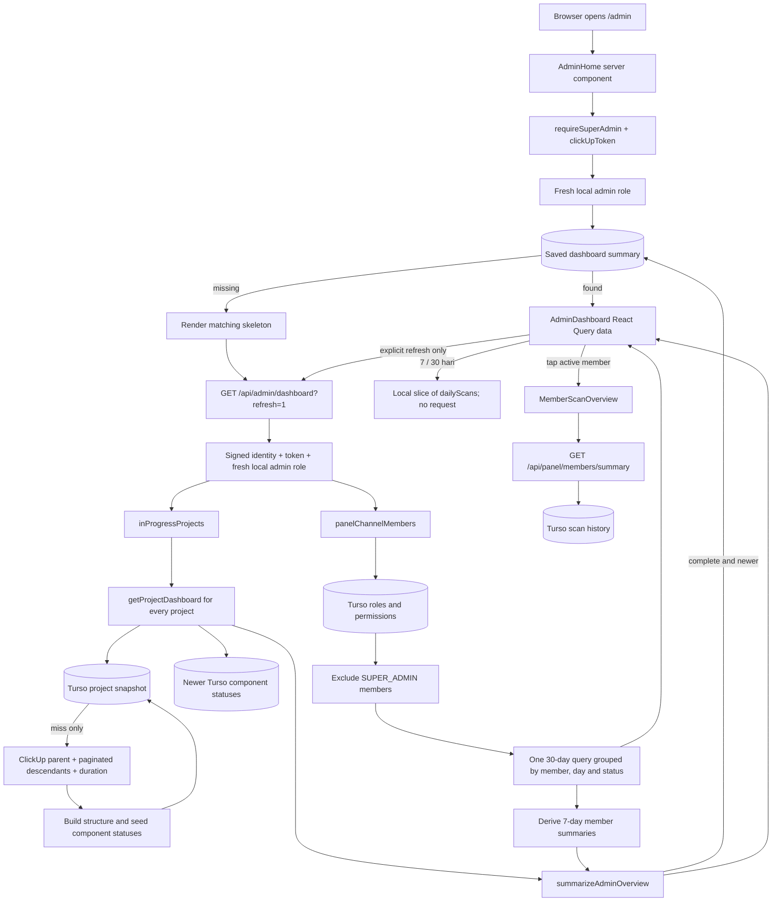

# AdminDashboard data flow, calculations, and edge cases

Reviewed: 2026-10-24. Describes the current working tree, including the cached dashboard endpoint and daily stacked scan chart. This is implementation documentation; live ClickUp/Turso contents and deployment behavior were not verified. Older plans such as [PLAN_ADMIN_DASHBOARD.md](PLAN_ADMIN_DASHBOARD.md) describe proposals and must not be treated as the current implementation.

## What the numbers measure

The dashboard combines two independent datasets:

| Dataset | Source | Unit and scope |
| --- | --- | --- |
| Barang tercatat, status distribution, returns | ClickUp project structure/custom field, stored project snapshot, then newer Turso `ppic_component_status` rows | Current components in listed in-progress projects, excluding supporting groups and `DIHAPUSKAN` |
| Scan hari ini, Scan 7 hari, Tim hari ini, Scan per hari | Turso `ppic_scan_history`, limited to current non-admin channel members | Recorded scan events across **all projects**, including repeated events and members whose scan access is now disabled |
| Enabled/active/idle/no access | Current channel roster plus Turso `ppic_permissions` and member summaries | People, not components or scan events |

A component can be scanned several times and contribute one current component but several history rows. `100%` recorded means every included component has a nonempty status; it does not mean every component is installed or every project is complete. History totals cannot be used as an inventory denominator.

## End-to-end flow



Initial page loading performs fresh local admin authorization and reads the saved presentation payload from `ppic_admin_dashboard_snapshot`. `AdminDashboard` receives that payload as React Query initial data; reopening, reloading, reconnecting, or changing the login token does not trigger a dashboard API request or calculation. Without a saved result, the shared `AdminDashboardSkeleton` appears while the first calculation runs. **Perbarui dashboard** explicitly requests a new calculation. The endpoint calls [`src/lib/adminDashboard.ts`](../src/lib/adminDashboard.ts); the payload remains `now`, `totals`, `projectsReady`, `projectCount`, `members`, and `dailyScans`. See [the endpoint contract](ADMIN_DASHBOARD_API.md).

### 1. Authentication and parallel loading

[`src/app/admin/(dashboard)/page.tsx`](../src/app/admin/(dashboard)/page.tsx), [`src/app/api/admin/dashboard/route.ts`](../src/app/api/admin/dashboard/route.ts), and `getAdminDashboard`:

1. Await `requireSuperAdmin()`, require the ClickUp token and signed-session identity, then check the current local `SUPER_ADMIN` role before reading any saved summary. Missing credentials redirect to `/login`; revoked/non-admin access redirects to `/unauthorized`.
2. Render the saved summary without another dashboard request. A first calculation or explicit refresh uses the endpoint, which independently checks signed-session identity, token, and fresh local admin role. Missing credentials return 401, revoked/non-admin access 403, unexpected failures 502.
3. On an aggregate cache rebuild, capture one `now = Date.now()` for the heading/history cutoff and run project and team branches with `Promise.allSettled`. A failure in one branch does not discard the other.
4. Within the project branch, load each dashboard concurrently with another `Promise.allSettled`. Keep fulfilled dashboards, but mark project totals unavailable unless **all** listed projects loaded.
5. Within the team branch, fetch the roster using the explicit token (no cookie read inside the cache), load local roles/permissions, exclude `SUPER_ADMIN`, and run one grouped 30-day history query. Derive every member's seven-day `today`, `total`, and `days` from those same rows. A grouped-history failure sets every member summary and `dailyScans` to null, while retaining the roster.

There is no concurrency limit on the per-project fan-out. The endpoint has `maxDuration = 60`; this is not a timeout on each operation. Home no longer runs per-member lifetime queries: history SQL statements fall from `2 * memberCount + 1` to one per aggregate rebuild.

The last complete presentation payload is stored in `ppic_admin_dashboard_snapshot`, scoped by a hash of signed admin user ID, Panel list, database URL, and chat workspace/channel configuration. It survives a new login token or Jakarta date and does not expire automatically. Partial calculations do not overwrite it; a conditional upsert prevents a slower older calculation from replacing a newer saved result. The header shows `Data terakhir` with the calculation date/time in WIB. Team labels such as `hari ini` refer to that saved calculation date until explicitly refreshed. A first-ever visit still needs a calculation. Client `staleTime` is infinite, with no polling, focus refetch, or reconnect refetch. Successful HTTP responses are `private, no-store`; authorization still runs on every page/API request. Ordinary endpoint reads reuse the saved result; `?refresh=1` calculates again.

### 2. Project fetching and freshness

[`src/lib/projects.ts`](../src/lib/projects.ts), [`src/lib/projectDashboard.ts`](../src/lib/projectDashboard.ts), and [`src/lib/db.ts`](../src/lib/db.ts):

| Operation | Request/storage | Behavior |
| --- | --- | --- |
| Project list | `GET https://api.clickup.com/api/v2/list/{panelListId}/task?statuses[]=in progress&page=N` | Starts at page 0; stops on `last_page` or empty tasks. Keeps only `!task.parent`. Does not request subtasks. Process-local cache keyed by token/status for 60 seconds. List ID uses `CLICKUP_PPIC_PANEL_LIST_ID` or `PANEL_LIST_ID`. |
| Project snapshot | `ppic_admin_project_snapshot` | Key is SHA-256 of `[token, panelListId(), project.task_id]`. Snapshot is isolated by access scope; stored JSON has no automatic expiry check. |
| Cold parent read | `GET /api/v2/task/{id}?include_subtasks=true` | Validates matching ID, no parent, and matching panel list. The embedded subtasks are not the component-count source. |
| Cold descendants | `GET /api/v2/team/{CLICKUP_TEAM_ID}/task?parent={id}&subtasks=true&include_closed=true&page=N` | Sequential pages, stop on `last_page` or empty array, reject non-array `tasks`, deduplicate by task ID. Uses the imported team constant. |
| Cold project duration | `GET /api/v2/task/{id}/time_in_status` | Non-OK/invalid JSON/non-in-progress status yields null duration; network rejection can still fail the build. Not displayed by the home dashboard. |
| Cold auxiliary reads | `getPpicProjectScanHistory`, `getPpicMemberNames` | Fetch history/names for the full reusable dashboard payload, although home totals do not use these fields. |
| Current status overlay | `getPpicProjectStatuses(projectId)` | Reads local status rows on every dashboard load; applies only rows with `updatedAt >= snapshot.statusUpdatedAt`. |

Cold builds run parent, duration, descendants, and project-history loading concurrently. The ClickUp build requests share one 45-second `AbortSignal.timeout`; this is a total signal lifetime, not a fresh 45 seconds per descendant page. Project-list and roster requests do not set this explicit timeout. There is no application retry/backoff in these helpers. ClickUp 429 maps to `RATE_LIMITED`; other non-OK parent/descendant/list responses map to `CLICKUP_ERROR`.

A 60-second database lease prevents simultaneous cold builds for the same scope. A contender can get `PROJECT_SYNC_IN_PROGRESS`; losing lease ownership can yield `PROJECT_SYNC_SUPERSEDED`. It does not wait for the other build. Failed refreshes retain any previously saved snapshot JSON.

**Loading can write local data:** a cold build seeds `ppic_component_status` and saves the snapshot. It performs no ClickUp mutation. Seeding only overwrites older local status timestamps, protecting updates recorded after the build started. Afterward, `applyProjectStatusChanges` overlays newer/equal status timestamps and removes `DIHAPUSKAN` components. It does not add missing components or move them between groups.

**Refresh is not Resync:** the home **Perbarui dashboard** and error buttons call `GET /api/admin/dashboard?refresh=1`. This waits for a rebuilt summary while keeping existing displayed data during the request. A failed HTTP refresh preserves that data and shows an error. Partial responses still show the existing incomplete-data warnings but do not replace the complete saved summary. Rebuilding can reuse the 60-second project list, cached roster, and persistent project snapshots. The home component has no polling, Ably subscription, or midnight timer. A project-specific `POST /api/project/sync` with `{ "task_id": "..." }` forces a project rebuild through `getProjectDashboard(..., true)`; the home button does not call it.

### 3. Which components are counted

The cold builder treats direct children of the project as **groups/items**. A descendant is a component only when it is below one of those groups and is not `DIHAPUSKAN`.

- `itemIdFor` walks parents until it finds the direct project child. Missing ancestry or a cycle yields no group, so that descendant is excluded.
- Intermediate descendants also qualify: there is no leaf-only or nonempty-serial requirement. A direct child remains a group even if it has a serial.
- The serial number is metadata; totals count component task objects, not unique serial numbers or quantities in a custom field.
- `summarizeAdminOverview` excludes groups named `MATERIAL REQUISITION FORM` or `HARDWARE LIST`, ignoring case and normalizing whitespace, then excludes deleted components again.
- `getScanStatus` reads `CF_PANEL.STATUS_BARANG_SCAN` through `statusBarangScanKey`, which accepts configured option IDs, keys, or indexes. Empty/unrecognized raw values normalize to null. Recognized production statuses such as `DRY_FIT` become `OTHER` in overview buckets because they are outside the four PPIC statuses.

The six overview buckets are `UNSCANNED`, `BARANG_DITERIMA`, `SEDANG_DIPACKING`, `TERPASANG_DIGUNAKAN`, `DALAM_PROSES_RETUR`, and `OTHER`. A falsy normalized status counts as `UNSCANNED`.

## Calculation reference

[`src/lib/adminOverview.ts`](../src/lib/adminOverview.ts) is the home aggregate source. Let `C` be the included components, `M` the current non-admin members, and `E` members with `hasAccess === true`.

| Value/UI | Exact calculation |
| --- | --- |
| `projectCount` | Number of projects returned by `inProgressProjects`, even if a per-project dashboard later fails |
| `total` | `C.length` |
| `recorded` | `total - count(UNSCANNED)`; returns and `OTHER` count as recorded |
| `percentage` | `total ? Math.round(recorded / total * 100) : 0`; component-weighted across projects, not an average of project percentages |
| `statuses` | Count each component once into the six tracking buckets |
| `returns` | `count(DALAM_PROSES_RETUR)`; current items, not return-history events |
| `today` / Scan hari ini | Sum `member.summary.today` over **all M**, including members without current scan access |
| `yesterday` | Sum `member.summary.days.at(-2).count` over all M |
| `change` / dibanding kemarin | `today - yesterday`, an absolute scan-count difference, not a percentage |
| `week` / Scan 7 hari | Sum `member.summary.total` over all M; always seven Jakarta calendar days |
| Seven-day average | `week / 7`, formatted with at most one decimal using `id-ID`; includes today and zero days |
| `enabled` | `E.length`; access requires local role MEMBER, `active = 1`, and a valid nonempty `allowed_status` list |
| `active` | Count E whose `summary.today > 0` |
| `idle` | Count E whose `summary.today === 0`; null summaries are not classified as idle |
| `noAccess` | `M.length - E.length` |

Missing summaries contribute zero inside the aggregate helper, but the client hides team KPI numbers when any member summary is missing. Do not display those internal partial sums as complete totals.

Example: 10 included components with 4 unscanned, 3 received, 1 packing, 1 return, and 1 `DRY_FIT` give `recorded = 6`, `percentage = 60`, and `returns = 1`. Extra scans of one component do not change these inventory totals. A 1/1 project and a 0/9 project together give 1/10 = 10%, not 50%.

### Member drawer summary calendar math

The separate drawer endpoint calls `getPpicMemberScanSummary(userId, "7", now)` against `ppic_scan_history` filtered by `clickup_user_id`; there is no ongoing-project filter. Home no longer calls this helper; it derives the equivalent seven-day fields from the batched query below.

1. Derive today's Jakarta date with UTC+7.
2. Build seven ascending date buckets, today minus six days through today, initialized to zero.
3. Query the current and preceding seven-day windows, grouping by `date(scanned_at, '+7 hours')` and status. Upper cutoff is `unixepoch(scanned_at) <= Math.floor(now / 1000)`; lower cutoff is midnight WIB at the start of the previous window.
4. Rows in the current seven dates increment `days`, `total`, and `statuses`; preceding rows increment `previousTotal`. `today` is the last bucket.
5. A second grouped query supplies all-time `lifetimeTotal`, `lifetimeStatuses`, and `lastScannedAt`. These fields are not used by the home team KPIs.

For `now = 2026-10-24 10:00 WIB`, the seven displayed days are October 18–24. October 17 17:00 UTC belongs to October 18 WIB. Today is partial, while yesterday is a full calendar day. Future timestamps are excluded to the query's second precision. Invalid/unparseable timestamps do not pass `unixepoch` comparisons. Unknown legacy history statuses count as `OTHER` rather than disappearing.

Repeated **stored history rows** count individually. This does not mean every camera detection counts: the scan route can return `skipped: true` for an already-matching status without inserting history. Its write flow is ClickUp status -> local component status -> scan history -> serial-cache update; a later failure can leave inventory/status ahead of history. See [`src/app/api/panel/scan/route.ts`](../src/app/api/panel/scan/route.ts).

### Stacked Scan per hari chart

`getPpicTeamScanOverview(memberIds, now)` runs one read-only query over the **last 30 Jakarta calendar days** for the same non-admin roster used by the home KPIs:

```sql
SELECT clickup_user_id, date(scanned_at, '+7 hours') AS day, status, COUNT(*) AS count
FROM ppic_scan_history
WHERE clickup_user_id IN (?, ...)
  AND unixepoch(scanned_at) >= ?
  AND unixepoch(scanned_at) <= ?
GROUP BY clickup_user_id, day, status
```

Member IDs and both time bounds are bound parameters. The lower bound is midnight WIB 29 days before today; the upper bound is `Math.floor(now / 1000)`. An empty roster returns 30 zero days and an empty summaries map without querying history. This helper makes no ClickUp calls or writes, and failures propagate for the loader to convert to null. The return value is `{ dailyScans, summaries }`; each summary contains seven ascending zero-filled `days`, `total`, and `today`. It omits unused lifetime, previous-period, and per-status member fields.

Each `dailyScans` entry has `date`, `count`, and `statuses` (the four `PPIC_STATUSES` plus `OTHER`). All dates/statuses are zero-filled; legacy statuses merge into `OTHER`.

| Chart behavior | Calculation |
| --- | --- |
| Default/toggle | Local `scanDays` state is 7 or 30; render `dailyScans.slice(-scanDays)`. No extra fetch or endpoint on toggle. Other KPI periods stay unchanged. |
| Bar total | `day.count = sum(day.statuses)`; the label above the bar is this event count |
| Bar height | `day.count / Math.max(1, ...visibleDayCounts) * 128` pixels; a shared scale within the selected period |
| Stacks | Flex weights use per-status counts; colors/legend labels come from `STATUS_COLOR_CONFIG` |
| OTHER | Show its stack/legend when at least one visible day contains legacy events |
| Labels | Seven-day view uses Indonesian weekdays; 30-day view uses day/month; final date is `Hari ini` |
| Narrow screens | Seven columns fit the card; 30 columns scroll inside a keyboard-focusable region, using 38 pixels per day as minimum chart width |
| Accessibility | Each ordered-list item exposes the full date, total, and per-status counts through its accessible name; decorative stacks are hidden from screen readers |

The last seven chart totals sum to `totals.week`, and the final bar equals `totals.today`, because chart and member metrics now use the same query result. Switching periods rescales heights: compare numeric totals, not pixel height across views. The aggregate cache reuses this consistent payload until a rebuild.

## Team list, attention, and detail fetching

`panelChannelMembers()` uses a cached ClickUp chat-channel roster (`unstable_cache`, `revalidate: 60`, tag `panel-members`), then `getPpicMemberAccess` reads local permissions during an aggregate rebuild. The roster comes from `GET /api/v3/workspaces/{workspaceId}/chat/channels/{channelId}/members`; the helper also verifies token identity/local admin status on a cache miss. It reads one roster response, with no pagination loop. Malformed member records are skipped. A non-array member collection becomes an empty list rather than a fetch failure.

`Tim hari ini` includes only members whose available summary has `today > 0`, sorted by today's count descending, seven-day count descending, then name. A member without access can still appear because historical events remain valid. Zero-scan members do not appear here. Each sparkline is independently normalized to that member's highest daily count with a 2px minimum; equal heights across different members do not imply equal counts.

`Perlu perhatian` has up to three **categories**, not one row per issue:

- Returns > 0 and projects ready -> `/admin/projects`.
- Idle enabled members > 0 and team ready -> `/admin/settings`.
- No-access members > 0 and roster available -> `/admin/settings`, even if a member summary failed.

Tapping a team member mounts `MemberScanOverview` with `memberId`. It independently fetches `GET /api/panel/members/summary?user_id={id}&period=7`, with selectable `30` and `month`. Query key is `["member-scan-summary", memberId, period]`, `staleTime: 0`, browser fetch `cache: "no-store"` and cancellation signal. Provider defaults disable retry and refetch-on-window-focus. It does not reuse the home summary prop.

The route requires signed-session identity and a fresh local SUPER_ADMIN role, validates the filter, and requires a local target permission record. Errors are 401 `UNAUTHORIZED`, 403 `FORBIDDEN`, 400 `INVALID_SUMMARY_FILTER`, 404 `MEMBER_NOT_FOUND`, and 502 `DATABASE_ERROR`. Success is `private, no-store`. See [the existing summary contract](../postman/member-scan-summary.md).

Drawer totals/statuses use the **selected period**. Its percentage change is `Math.round((total - previousTotal) / previousTotal * 100)`, or unavailable when previousTotal is zero. `month` means month-to-date compared with the same number of preceding calendar days, not the complete previous month. `lastScannedAt` remains all-time. Closing unmounts the detail component. A drawer request uses a later `now`, so it may differ from the home snapshot near a new scan or midnight.

## Edge cases and visible outcomes

| Case | Current outcome / interpretation |
| --- | --- |
| No ongoing projects | Project branch succeeds: 0 projects, 0 components, 0%. Team history can still be nonzero. |
| Ongoing project with no countable components | Included in project count; contributes zero to denominator. An all-empty inventory shows 0%, not 100%. |
| One project dashboard fails | `projectsReady = false`; inventory percentage/count/status bar and return alert are withheld. Listed project count can still be known. |
| Entire project-list request fails | Project count becomes null and displays a dash; team data can remain available. |
| Grouped history query fails | `teamReady = false`; member summaries and chart become unavailable together, team KPIs and idle alert are withheld, and roster-based no-access alerts can still appear. Inventory can still render. Zero bars are not substituted for a failure. |
| Roster/permission load fails | Members and daily chart become null; inventory can still render. |
| Empty roster or only admins | `members = []` is a ready team (`every` is true); team KPIs are zero, chart has zero days, and list shows no active members. |
| No scans in selected chart period | Zero totals remain visible for every date plus an explicit empty-period message. |
| Access disabled after earlier scans | That member's events stay in totals/chart/list; they do not count toward active/enabled/idle. A nonzero scan count with `active = 0` is possible. |
| Member leaves channel or becomes SUPER_ADMIN | Their history is excluded from home team reporting on a refreshed roster/role load; this is not a permanent all-company history total. |
| Channel member has no local permission record | No scan access by default. Initial helper can read their history, but tapping them may yield drawer 404 until a local record exists. |
| Supporting group or deleted component has history | Inventory excludes it, but member-history reports still include its stored events; no history-side group/status deletion filter exists. |
| New/deleted/reparented ClickUp tasks | Existing snapshot structure does not change from a status overlay. A project Resync is needed; home refresh alone does not force it. |
| Status-only update | Refreshed home can reflect a newer local overlay; an already-open home does not receive it automatically. Unknown component IDs are ignored by the overlay. |
| Old snapshot component already removed as DIHAPUSKAN | An overlay cannot recreate it; rebuilding structure is needed to reintroduce a component omitted from the saved snapshot. |
| Near-100% after rounding | `Math.round` may display 100% with a small unscanned remainder, e.g. 200/201. Read the exact recorded/total values. |
| No attention rows but incomplete data | Shows waiting text when project/team summaries are incomplete. A chart-only failure has its own warning and does not alter the attention-category rules. |

## Verification and maintenance

Checks run for this change:

```sh
node --experimental-strip-types tests/team-daily-scans.cjs
node --experimental-strip-types tests/admin-overview.cjs
node --experimental-strip-types tests/member-scan-summary.cjs
npx tsc --noEmit --pretty false
npm run build
# Start the existing local ClickUp simulation, then run the home UI check:
postman simulation run postman/simulations/admin-dashboard.sim.yaml --port 4900 --output ndjson
node tests/admin-home.cjs
git diff --check
```

The daily-query check uses an in-memory database and blocks outbound fetches. It asserts one SQL statement for all home history data and covers WIB midnight/window boundaries, future-row exclusion, repeated events, legacy-status stacks, caller-supplied roster scope, zero days, leap day, errors, and exact agreement with existing seven-day member summaries. The overview/member-summary checks cover existing formulas and summary authorization/calendar behavior.

The home browser check uses a local database and the repository's synthetic ClickUp Postman simulation. It checks totals, four stacked statuses, 7/30 switching, contained horizontal scrolling at 320/390/1440px, member detail, and empty/error states. API/browser checks cover saved-result reuse without automatic requests, login-token rotation and old calculation dates, explicit refresh after database changes, fresh page/API authorization, isolated admin accounts, incomplete-result retention, concurrent refresh ordering, and the shared skeleton during a cold load. This verifies local rendering/integration; it does not establish live ClickUp completeness, production latency, database scale, deployed behavior, or touch-device behavior.

When changing this flow, review `AdminHome`, `AdminDashboard`, `/api/admin/dashboard`, `adminDashboard`, `adminOverview`, `projectDashboard`, `projects`, `projectStatus`, `db`, `session`, `MemberScanOverview`, `ReactQueryProviders`, and `types/ppic` together. Keep current-component counts separate from event counts, and keep the home chart's roster/timezone aligned with the home team KPIs. Member drawer code is dynamically imported when opened rather than included in the initial dashboard chart bundle.
