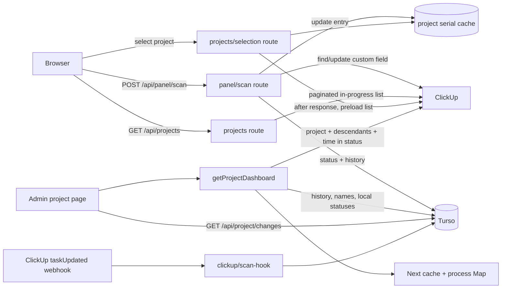

# TrackerProd data flow

## Scope and evidence

- **Confirmed:** This document is a static trace of `src/`; no ClickUp, Turso, webhook, or deployment call was made for this audit.
- **Confirmed:** Browser calls are made from `src/features/member/MemberScannerPage.tsx`, `src/features/member/MemberProjects.tsx`, `src/features/admin/ProjectDetailPage.tsx`, and the hooks in `src/hooks/`.
- **Unverified:** Live latency, payload sizes, cache hit rates, and the actual ClickUp/Turso contents require runtime instrumentation or read-only production observation.

## PPIC scan

1. **Confirmed:** `MemberScannerPage` POSTs `{ serial_number, status }` to `src/app/api/panel/scan/route.ts`.
2. **Confirmed:** The route parses and trims the serial, maps only the four `PPIC_STATUSES` values in `targetFor`, calls `requireFreshPpicStatusAccess`, rejects a super-admin scanner session, and requires a selected project cookie.
3. **Confirmed:** `projectSerialCache(mainTaskId)` is read first. A cached matching status returns `skipped: true`; a complete cache without that serial returns `403 SERIAL_NOT_IN_SELECTED_PROJECT`.
4. **Confirmed:** On a cache miss, `findSerial` queries ClickUp list tasks with `include_closed=true`, `subtasks=true`, and an exact `CF_PANEL.SERIAL_NUMBER` custom-field filter. It rejects no/multiple rows, foreign project scope, invalid hierarchy, and mismatched serial data before caching the task mapping.
5. **Confirmed:** `updateStatus` POSTs the target ClickUp dropdown option to `/api/v2/task/{taskId}/field/{STATUS_BARANG_SCAN}`. Only after that succeeds, the route updates `ppic_component_status`, inserts `ppic_scan_history`, and updates the Turso serial-cache JSON entry.
6. **Confirmed:** Errors become JSON codes such as `RATE_LIMITED`, `CLICKUP_STATUS_UPDATE_FAILED`, and `SCAN_HISTORY_SAVE_FAILED`; the client displays a mapped toast in `MemberScannerPage`.
7. **Inferred:** A failure after ClickUp accepts the custom-field write can leave ClickUp ahead of Turso and return an error to the browser, because there is no cross-system transaction or compensating write.

## Project picker and cache warm-up

1. **Confirmed:** `useProjects` GETs `/api/projects`; `inProgressProjects` in `src/lib/projects.ts` paginates the ClickUp panel list for `in progress` tasks, removes child tasks, and keeps a token-keyed process-local `Map` for 60 seconds.
2. **Confirmed:** React Query keeps the browser project list indefinitely until the user presses Sync, which calls `/api/projects?refresh=1`.
3. **Confirmed:** `POST /api/projects/selection` rechecks that the requested project is in `inProgressProjects`, signs `ppic_selected_project`, and for member sessions schedules `clearProjectSerialCache` plus `preloadProjectSerialCache` with `after()`.
4. **Confirmed:** `preloadProjectSerialCache` performs another paginated ClickUp list traversal, filters tasks by `Related Order Number` and hierarchy, removes duplicate serials, then stores one eight-hour Turso JSON cache record per project.
5. **Inferred:** Selecting a project can be slow or rate-limit-prone when the panel list is large because the asynchronous preload reads every list page; the browser response is not blocked, but the background work shares the ClickUp account quota.

## Dashboard load and local delta refresh

1. **Confirmed:** `src/app/admin/project/page.tsx` obtains the selected/admin-supplied project and ClickUp token, then calls `getProjectDashboard`.
2. **Confirmed:** `buildProjectDashboard` concurrently loads the parent task, its ClickUp `time_in_status`, paginated descendant tasks, Turso scan history, and then Turso member names. It groups descendants into items/components and seeds `ppic_component_status` from the ClickUp-derived status snapshot.
3. **Confirmed:** Parent-task and time-in-status fetches request Next cache revalidation after 30 seconds; descendants use a 60-second process-local `Map`; `cachedProjectDashboard` uses `unstable_cache` with `revalidate: false` and tag `clickup-project-data`.
4. **Confirmed:** Before rendering, `getProjectDashboard` overlays every current `ppic_component_status` row with `applyProjectStatusChanges`.
5. **Confirmed:** The client calls `POST /api/project/sync` to clear the descendant `Map` and revalidate the tag. It also polls `GET /api/project/changes?project=...&since=...` every 30 seconds and applies returned Turso status deltas.
6. **Inferred:** Structural ClickUp edits (new/deleted/reparented tasks or project metadata) can remain stale until a successful `/api/project/sync`, because the delta route carries only local status rows and the dashboard cache has no time revalidation.

## External status webhook

1. **Confirmed:** `POST /api/clickup/scan-hook` verifies `x-signature` against an HMAC-SHA256 over the raw body using `CLICKUP_SCAN_HOOK_SECRET`, with a timing-safe comparison.
2. **Confirmed:** It only reacts to a matching `STATUS BARANG SCAN` custom-field history item, maps its value with `statusBarangScanKey`, and updates an existing `ppic_component_status` row. Otherwise it returns `{ ignored: true }`.
3. **Unverified:** ClickUp delivery configuration, signature-header format in production, retries, and whether every relevant task update reaches this endpoint were not exercised.
